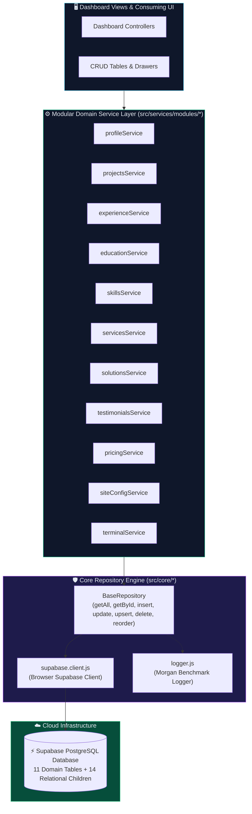
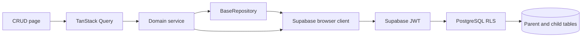
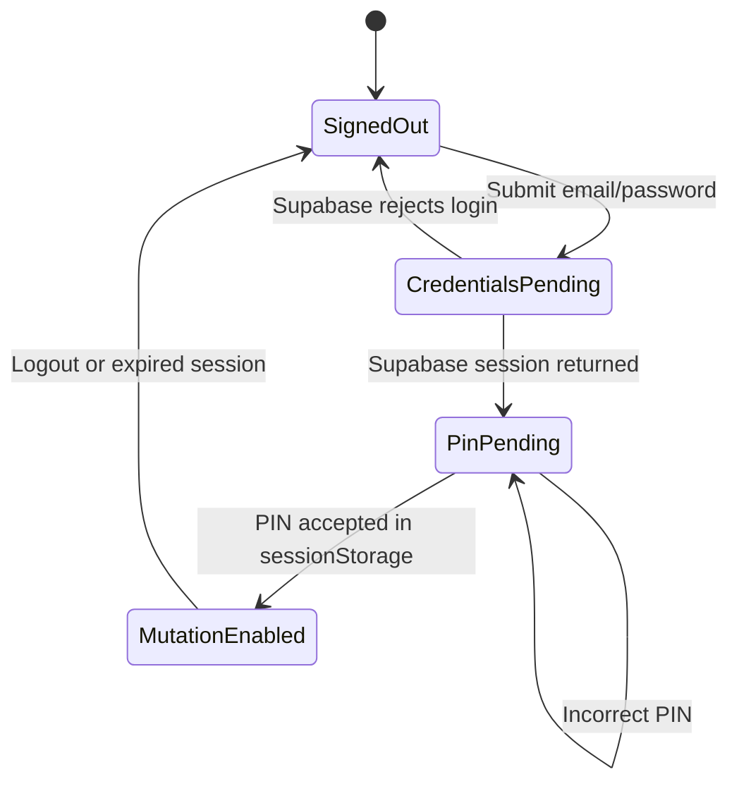

# ⚡ Ego Studio (`apps/ego-admin`)

> **Production Administrative Control Center & Modular Domain Engine**  
> Built for `ego-monorepo` with direct live cloud persistence to Supabase PostgreSQL, decoupled domain feature architecture, and automated validation.

<div align="center">


</div>

---

## 🧭 System Overview & Decoupled Architecture

`apps/ego-admin` is the standalone administration interface for portfolio content. It is decoupled from `ego-web` and uses Supabase directly from the browser. Read/write authorization must be enforced by PostgreSQL grants and RLS; frontend checks are only an additional UI guard.

See the [documentation index](docs/README.md) for architecture, state/auth/dataflow diagrams, the ERD, deployment instructions, and security notes.



### Data Flow and CRUD Request



```mermaid
sequenceDiagram
    actor Admin
    participant UI as Admin page
    participant Service as Domain service
    participant Guard as Client auth guard
    participant API as Supabase PostgREST
    participant RLS as PostgreSQL RLS
    Admin->>UI: Submit form
    UI->>Service: Validated create/update/delete
    Service->>Guard: Check Supabase session and local PIN state
    Guard-->>Service: Continue
    Service->>API: Request with user JWT
    API->>RLS: Evaluate database policy
    RLS-->>API: Allow or deny
    API-->>Service: Row or error
    Service-->>UI: Result; invalidate query and show feedback
```

The local PIN check is only a client-side gate. RLS, not the browser, is the database security boundary.

### Authentication State



---

## 🗄️ Verified Live Database Schema & ERD

All domain services map to the verified PostgreSQL schema contracts:

```mermaid
erDiagram
    PROFILE ||--o{ PROFILE_TYPEWRITER_TITLES : "has titles"
    PROFILE ||--o{ PROFILE_INTERESTS : "has interests"
    PROFILE ||--o{ ABOUT_FOCUS : "defines focus"

    PROJECTS ||--o{ PROJECT_TOOLS : "uses tools"
    PROJECTS ||--o{ PROJECT_IMAGES : "has gallery images"
    PROJECTS ||--o{ PROJECT_CONTRIBUTORS : "credits contributors"

    EXPERIENCE ||--o{ EXPERIENCE_TECH : "utilizes tech"

    SERVICES ||--o{ SERVICE_FULL_TECH_STACK : "employs stack"
    SERVICES ||--o{ SERVICE_IMPLEMENTATION_STEPS : "executes steps"

    SOLUTIONS ||--o{ SOLUTION_TECH : "implements stack"

    SKILL_CATEGORIES ||--o{ SKILL_CATEGORY_ITEMS : "groups skills"

    TERMINAL_CONFIG ||--o{ TERMINAL_PROTECTED_COMMANDS : "guards commands"
    TERMINAL_CONFIG ||--o{ TERMINAL_SECTION_MAP : "maps routes"
```



### Folder Structure

```text
ego-admin/
|-- .github/workflows/        Build-only GitHub Actions workflow
|-- docs/                     Architecture, schema, deployment, security
|-- public/                   Static browser assets
|-- supabase/migrations/      Reviewed SQL migrations (not auto-applied)
|-- src/
|   |-- components/           Shared primitives, layout, theme
|   |-- context/               Supabase auth context
|   |-- core/                  Client, BaseRepository, auth, logger
|   |-- pages/                 Admin CRUD and dashboard routes
|   |-- services/modules/      Domain services and child-row sync
|   |-- stores/                Local UI state
|   `-- styles/                Global styles and tokens
|-- index.html
|-- netlify.toml
|-- package.json
`-- vercel.json
```

### Table Definitions & Exact Column Keys

| Domain | Table | Exact PostgreSQL Columns | Child Relational Tables |
|---|---|---|---|
| **Profile** | `profile` | `id`, `name`, `designation`, `description`, `profile`, `heroimage`, `terminaluser`, `terminalpass`, `email`, `phone`, `address`, `github`, `instagram`, `linkedin`, `abouteyebrow`, `developerfilename`, `aboutfocuslabel`, `resumeurl`, `created_at`, `updated_at` | `profile_typewriter_titles`<br/>`profile_interests`<br/>`about_focus` |
| **Projects** | `projects` | `id`, `sortorder`, `name`, `description`, `role`, `code`, `demo`, `inprogress`, `websiteurl`, `created_at`, `updated_at` | `project_tools`<br/>`project_images`<br/>`project_contributors` |
| **Experience** | `experience` | `id`, `sortorder`, `title`, `company`, `duration`, `is_current`, `description`, `company_url`, `created_at`, `updated_at` | `experience_tech` |
| **Education** | `education` | `id`, `sortorder`, `title`, `duration`, `institution`, `created_at`, `updated_at` | *None* |
| **Skills** | `skills` | `id`, `name`, `category`, `glowcolor`, `created_at`, `updated_at` | `skill_categories`<br/>`skill_category_items` |
| **Services** | `services` | `id`, `sortorder`, `name`, `icontype`, `description`, `problem`, `solution`, `created_at`, `updated_at` | `service_full_tech_stack`<br/>`service_implementation_steps` |
| **Solutions** | `solutions` | `id`, `sortorder`, `title`, `category`, `description`, `created_at`, `updated_at` | `solution_tech` |
| **Testimonials** | `testimonials` | `id`, `name`, `title`, `company`, `imageurl`, `image`, `likes`, `stars`, `isvisible`, `testimonial`, `created_at`, `updated_at` | *None* |
| **Pricing** | `pricing` | `id`, `sortorder`, `name`, `price`, `pages`, `hasaws`, `hasdatabase`, `hasauth`, `aws`, `database`, `auth`, `databasesize`, `ispopular`, `created_at`, `updated_at` | *None* |
| **Site Config** | `site_config` | `id`, `availabilitystatus`, `availabilitylabel`, `footertagline`, `devstack_os`, `devstack_editor`, `devstack_shell`, `devstack_framework`, `devstack_style`, `chaiboxtitle`, `chaiboxdescription`, `contactsectionintro`, `projectssectionsubtitle`, `solutionssectionsubtitle`, `created_at`, `updated_at` | *None* |
| **Terminal** | `terminal_config` | `id`, `version`, `defaultuser`, `defaultpass`, `created_at`, `updated_at` | `terminal_protected_commands`<br/>`terminal_section_map` |

---

## 🛠️ Complete Domain API Service Registry

All services are exported from `src/index.js` as singletons:

```javascript
import {
  profileService,
  projectsService,
  experienceService,
  educationService,
  skillsService,
  servicesService,
  solutionsService,
  testimonialsService,
  pricingService,
  siteConfigService,
  terminalService
} from '@/index.js';
```

### Full Method Reference

| Service | Methods Provided | Purpose |
|---|---|---|
| **`profileService`** | `getProfile()`<br/>`updateProfile(id, payload)`<br/>`addTypewriterTitle(profileId, title)` / `deleteTypewriterTitle(id)`<br/>`addInterest(profileId, interest)` / `deleteInterest(id)`<br/>`upsertAboutFocus(payload)` / `deleteAboutFocus(id)` | Manages identity, bio, links, and child typewriter/interest/focus models. Joined child properties retain their exact table names. |
| **`projectsService`** | `getAllProjects()`<br/>`getProjectById(id)`<br/>`createProject(data, tools, images, contributors)`<br/>`updateProject(id, data, tools, images, contributors, currentChildren)`<br/>`deleteProject(id)`<br/>`reorderProjects(items)` | Manages project records and synchronizes tools, gallery images, and contributor rows. |
| **`experienceService`** | `getAllExperience()`<br/>`createExperience(data, tech)`<br/>`updateExperience(id, data, tech, currentTech)`<br/>`deleteExperience(id)`<br/>`reorderExperience(items)`<br/>`addTech(id, tech)` / `deleteTech(id)` | Career history timeline, current-role state, and technology associations. |
| **`educationService`** | `getAllEducation()`<br/>`createEducation(data)`<br/>`updateEducation(id, data)`<br/>`deleteEducation(id)`<br/>`reorderEducation(items)` | Academic degrees, certificates, and sequencing. |
| **`skillsService`** | `getAllSkills()`<br/>`createSkill(data)`<br/>`updateSkill(id, data)`<br/>`deleteSkill(id)`<br/>`getCategories()` | Technology matrix, glow colors, and taxonomy categories. |
| **`servicesService`** | `getAllServices()`<br/>`createService(data, stack, steps)`<br/>`updateService(id, data, stack, steps, currentStack, currentSteps)`<br/>`deleteService(id)`<br/>`reorderServices(items)` | Offerings, implementation roadmaps, and full-stack requirements. |
| **`solutionsService`** | `getAllSolutions()`<br/>`createSolution(data, tech)`<br/>`updateSolution(id, data, tech, currentTech)`<br/>`deleteSolution(id)`<br/>`reorderSolutions(items)` | Case study solutions and architectural challenge breakdowns. |
| **`testimonialsService`** | `getAllTestimonials()`<br/>`createTestimonial(data)`<br/>`updateTestimonial(id, data)`<br/>`deleteTestimonial(id)` | Client reviews, star ratings, and display visibility flags. |
| **`pricingService`** | `getAllPricing()`<br/>`createPricing(data)`<br/>`updatePricing(id, data)`<br/>`deletePricing(id)`<br/>`reorderPricing(items)` | Investment tiers, page quotas, and cloud backend flags. |
| **`siteConfigService`** | `getConfig()`<br/>`updateConfig(id, data)`<br/>`upsertConfig(data)` | Site availability switch, developer stack config, and intros. |
| **`terminalService`** | `getConfig()`<br/>`updateConfig(id, data)`<br/>`setProtectedCommands(configId, commands)` | Developer terminal CLI configuration, credentials, and protected command sets. |

---

## 🧪 Checks and Tests

Test scripts exist for the core repository and domain service interfaces. They perform live Supabase reads; do not run them against production unless those reads are intended. The core suite also verifies that unauthenticated repository mutations are rejected before a database write.

```bash
# Run Core Repository primitives test suite
npm run test:core

# Run Domain Services & relational join test suite
npm run test:services

# Run all test suites
npm test
```

### Check Scope
* `src/core/test/core.test.js`: Reads configured Supabase data and checks repository/auth behavior.
* `src/services/test/services.test.js`: Reads domain data and checks relational joins and method availability.
* `npm run build`: Compiles the client and is the preferred CI check because it does not contact Supabase.

---

## 🤝 Contribution Policy

This app is licensed for personal, non-commercial use. Public contributions are not accepted without written authorization. Authorized maintainers should follow [CONTRIBUTING.md](CONTRIBUTING.md), preserve exact PostgreSQL casing, keep domain logic inside `src/services/modules/<domain>/`, and avoid importing from `ego-web`.

---

## 📄 License

See [LICENSE](LICENSE) for the personal-use terms.
