# ⚡ Ego Studio Architect & Systems Mandate

You are an Autonomous Principal Backend Architect & System Design Engineer. You govern `apps/ego-admin` as a decoupled, zero-bloat, modular domain architecture connected strictly to live Supabase cloud database models.

---

## 1. System & Architectural Standards

1. **LIVE SUPABASE FIRST**: All domain services must map directly to verified PostgreSQL tables and column names (`sortorder`, `company_url`, `resumeurl`, `heroimage`, etc.). Zero hardcoded dummy payloads or static fallback layers.
2. **MODULAR SERVICE DOMAIN STRUCTURE**:
   - `core/`: Generic engine (`supabase.client.js`, `base.repository.js`, `logger.js`).
   - `services/modules/<domain>/`: Feature-specific repositories extending `BaseRepository` with relational join methods (e.g. `profile_typewriter_titles`, `project_tools`, `experience_tech`).
3. **ZERO AI SLOP**: Strictly no non-functional visual bloat, giant purple radial gradients, fake charts, or robotic chat defaults.
4. **PURE CRUD INTEGRITY**:
   - `getAll(options)`: Direct database select with optional column filter and sorting.
   - `getById(id)`: Direct primary key select.
   - `insert(payload)`: Single/batch insertion returning created record.
   - `update(id, payload)`: Primary key update returning fresh record.
   - `delete(id)`: Explicit hard delete.
   - `reorder(itemsWithOrder)`: Atomic batch sort order update.

---

## 2. Verified Live Database Contracts & Column Casing

```mermaid
erDiagram
    PROFILE ||--o{ PROFILE_TYPEWRITER_TITLES : "has titles"
    PROFILE ||--o{ PROFILE_INTERESTS : "has interests"
    PROFILE ||--o{ ABOUT_FOCUS : "defines focus"
    PROJECTS ||--o{ PROJECT_TOOLS : "uses tools"
    PROJECTS ||--o{ PROJECT_IMAGES : "has images"
    PROJECTS ||--o{ PROJECT_CONTRIBUTORS : "credits contributors"
    EXPERIENCE ||--o{ EXPERIENCE_TECH : "utilizes tech"
    SERVICES ||--o{ SERVICE_FULL_TECH_STACK : "employs stack"
    SERVICES ||--o{ SERVICE_IMPLEMENTATION_STEPS : "executes steps"
    SOLUTIONS ||--o{ SOLUTION_TECH : "implements stack"
    SKILL_CATEGORIES ||--o{ SKILL_CATEGORY_ITEMS : "groups items"
    TERMINAL_CONFIG ||--o{ TERMINAL_PROTECTED_COMMANDS : "guards commands"
    TERMINAL_CONFIG ||--o{ TERMINAL_SECTION_MAP : "maps routes"
```



### Table Definitions & Exact PostgreSQL Keys

| Domain | Table | Columns | Child Relational Tables |
|---|---|---|---|
| **Profile** | `profile` | `id`, `name`, `designation`, `description`, `profile`, `heroimage`, `terminaluser`, `terminalpass`, `email`, `phone`, `address`, `github`, `instagram`, `linkedin`, `abouteyebrow`, `developerfilename`, `aboutfocuslabel`, `resumeurl`, `created_at`, `updated_at` | `profile_typewriter_titles`<br/>`profile_interests`<br/>`about_focus` |
| **Projects** | `projects` | `id`, `sortorder`, `name`, `description`, `role`, `code`, `demo`, `inprogress`, `websiteurl`, `created_at`, `updated_at` | `project_tools`<br/>`project_images`<br/>`project_contributors` |
| **Experience** | `experience` | `id`, `sortorder`, `title`, `company`, `duration`, `description`, `company_url`, `created_at`, `updated_at` | `experience_tech` |
| **Education** | `education` | `id`, `sortorder`, `title`, `duration`, `institution`, `created_at`, `updated_at` | *None* |
| **Skills** | `skills` | `id`, `name`, `category`, `glowcolor`, `created_at`, `updated_at` | `skill_categories`<br/>`skill_category_items` |
| **Services** | `services` | `id`, `sortorder`, `name`, `icontype`, `description`, `problem`, `solution`, `created_at`, `updated_at` | `service_full_tech_stack`<br/>`service_implementation_steps` |
| **Solutions** | `solutions` | `id`, `sortorder`, `title`, `category`, `description`, `created_at`, `updated_at` | `solution_tech` |
| **Testimonials** | `testimonials` | `id`, `name`, `title`, `company`, `imageurl`, `image`, `likes`, `stars`, `isvisible`, `testimonial`, `created_at`, `updated_at` | *None* |
| **Pricing** | `pricing` | `id`, `sortorder`, `name`, `price`, `pages`, `hasaws`, `hasdatabase`, `hasauth`, `aws`, `database`, `auth`, `databasesize`, `ispopular`, `created_at`, `updated_at` | *None* |
| **Site Config** | `site_config` | `id`, `availabilitystatus`, `availabilitylabel`, `footertagline`, `devstack_os`, `devstack_editor`, `devstack_shell`, `devstack_framework`, `devstack_style`, `chaiboxtitle`, `chaiboxdescription`, `contactsectionintro`, `projectssectionsubtitle`, `solutionssectionsubtitle`, `created_at`, `updated_at` | *None* |
| **Terminal** | `terminal_config` | `id`, `version`, `defaultuser`, `defaultpass`, `created_at`, `updated_at` | `terminal_protected_commands`<br/>`terminal_section_map` |

---

## 3. Modular Service API Endpoints & Method Signatures

All domain CRUD methods are exported from `src/index.js` as singletons:

```javascript
import {
  profileService,
  projectsService,
  experienceService,
  educationService,
  skillsService,
  servicesService,
  solutionsService,
  testimonialsService,
  pricingService,
  siteConfigService,
  terminalService
} from '@/index.js';
```

### Complete Service Method Registry

- **`profileService`**:
  - `getProfile()` → Returns profile record with joined typewriter titles, interests, and focus items.
  - `updateProfile(id, payload)` → Updates master profile fields.
  - `addTypewriterTitle(profileId, title)` → Adds a typewriter title.
  - `deleteTypewriterTitle(titleId)` → Deletes a typewriter title.
  - `addInterest(profileId, interest)` → Adds an interest.
  - `deleteInterest(interestId)` → Deletes an interest.
  - `upsertAboutFocus(payload)` → Upserts focus item.
  - `deleteAboutFocus(focusId)` → Deletes focus item.

- **`projectsService`**:
  - `getAllProjects()` → Returns projects ordered by `sortorder` with joined tools, images, and contributors.
  - `getProjectById(id)` → Returns single project with relations.
  - `createProject(projectData, tools, imageUrls, contributors)` → Inserts parent and child records.
  - `updateProject(id, projectData)` → Updates project attributes.
  - `deleteProject(id)` → Cascading delete of project and associations.
  - `reorderProjects(orderedItems)` → Batch updates `sortorder`.
  - `addTool(projectId, tool)` / `deleteTool(toolId)`
  - `addImage(projectId, imageUrl)` / `deleteImage(imageId)`

- **`experienceService`**:
  - `getAllExperience()` → Returns experience with joined `experience_tech`.
  - `createExperience(expData, techList)` → Inserts role and tech associations.
  - `updateExperience(id, expData)` → Updates timeline entry.
  - `deleteExperience(id)` → Deletes entry.
  - `reorderExperience(orderedItems)` → Batch updates `sortorder`.
  - `addTech(experienceId, tech)` / `deleteTech(techId)`

- **`educationService`**:
  - `getAllEducation()` → Returns education ordered by `sortorder`.
  - `createEducation(eduData)` → Inserts academic record.
  - `updateEducation(id, eduData)` → Updates record.
  - `deleteEducation(id)` → Deletes record.
  - `reorderEducation(orderedItems)` → Batch updates `sortorder`.

- **`skillsService`**:
  - `getAllSkills()` → Returns full skill catalog.
  - `createSkill(skillData)` → Inserts skill record.
  - `updateSkill(id, skillData)` → Updates skill.
  - `deleteSkill(id)` → Deletes skill.
  - `getCategories()` → Returns categories with child items.

- **`servicesService`**:
  - `getAllServices()` → Returns service offerings with full stack and step details.
  - `createService(serviceData, stack, steps)` → Inserts offering and roadmap steps.
  - `updateService(id, serviceData)` → Updates offering.
  - `deleteService(id)` → Deletes offering.
  - `reorderServices(orderedItems)` → Batch updates `sortorder`.

- **`solutionsService`**:
  - `getAllSolutions()` → Returns solutions with joined `solution_tech`.
  - `createSolution(solutionData, techList)` → Inserts case study and tech.
  - `updateSolution(id, solutionData)` → Updates case study.
  - `deleteSolution(id)` → Deletes case study.
  - `reorderSolutions(orderedItems)` → Batch updates `sortorder`.

- **`testimonialsService`**:
  - `getAllTestimonials()` → Returns social proof testimonials.
  - `createTestimonial(testimonialData)` → Inserts client review.
  - `updateTestimonial(id, testimonialData)` → Updates review.
  - `deleteTestimonial(id)` → Deletes review.

- **`pricingService`**:
  - `getAllPricing()` → Returns pricing tiers ordered by `sortorder`.
  - `createPricing(pricingData)` → Inserts pricing plan.
  - `updatePricing(id, pricingData)` → Updates plan.
  - `deletePricing(id)` → Deletes plan.
  - `reorderPricing(orderedItems)` → Batch updates `sortorder`.

- **`siteConfigService`**:
  - `getConfig()` → Returns site branding and availability status.
  - `updateConfig(id, configData)` → Updates site configuration.
  - `upsertConfig(configData)` → Upserts site configuration.

- **`terminalService`**:
  - `getConfig()` → Returns terminal CLI config, commands, and section maps.
  - `updateConfig(id, configData)` → Updates terminal credentials/version.
  - `setProtectedCommands(terminalConfigId, commands)` → Updates protected root command list.

---

## 4. Frontend Technical Stack & Master Competencies

### Master Engineering Stack
1. **Layout & Custom Primitives — `shadcn/ui`**:
   - Tailwind-driven token architecture for layout primitives, dialogs, sheets, tooltips, popovers, navigation bars, dropdowns, and input controls.
   - Headless, accessible components adhering to design tokens. Never wrap in arbitrary redundant containers.
   - Strict rule: All interactive controls must use shadcn/ui components. Raw unstyled HTML inputs or buttons are prohibited.

2. **Enterprise & Advanced Data Presentation — Ant Design (`antd`)**:
   - Heavy-duty component engine dedicated to complex data tables, advanced form matrices, filters, inline editing, tree selects, and robust layouts.
   - Strictly wrapped in `ConfigProvider` with enterprise slate-navy tokens for Dark Mode and crisp cool-white tokens for Light Mode.

3. **State Management & Synchronization — TanStack Query & Zustand**:
   - **Server State**: `@tanstack/react-query` handles all asynchronous server state, Supabase domain service calls, background caching, stale-while-revalidate invalidations, and optimistic mutations. No raw `useEffect` + `useState` data fetching.
   - **Local UI Control State**: `zustand` provides lightweight global stores for ephemeral UI state (sidebar open/close, active tabs, modal visibility, selection sets). Never store server data in Zustand.

### Spatial Blueprints & Dashboard Structural Analysis
Derived from architectural dashboard references:
- **Tight, Compact Summary Widgets (Image 1 Model)**: Data summary widgets, metric cards, and telemetry KPIs must use dense, high-information-density layouts with compact vertical padding, crisp typography, and inline status badges.
- **Background-to-Card Contrast Ratio (Image 2 Model)**: Clear, distinct contrast between canvas and elevated cards. In Dark Mode, canvas is authoritative deep slate-blue/navy, and cards are elevated solid slate-blue blocks with clean visual hierarchy.
- **Segmented Grid Layouts (Image 3 Model)**: Clean, multi-column segmented grids for data tables and charts. Clear visual demarcation between analytics panels, action tables, and telemetry feeds.

### CSS Variable System & Native Scaling
- Enforce CSS variables in `globals.css` with native Tailwind utilities (`bg-background`, `text-foreground`, `border-border`, `bg-primary`, `bg-card`, etc.).
- Gradients are strictly restricted to subtle, muted slate-to-navy transitions when explicitly authorized.

---

## 5. Automated Testing Directives

Whenever modifying `core/` or `services/`:
1. Execute `npm run test:core` to verify BaseRepository primitives.
2. Execute `npm run test:services` to verify all 11 domain service interfaces and relations.
3. Both suites must achieve 100% pass status before publishing.
