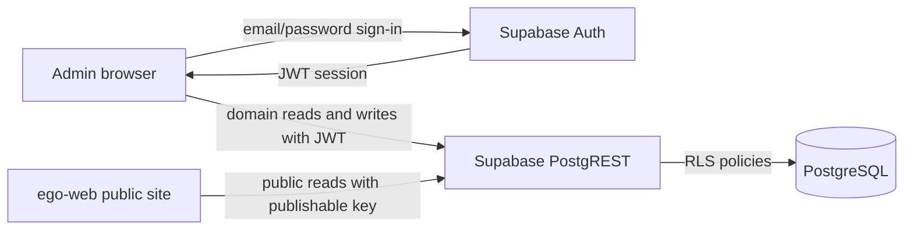
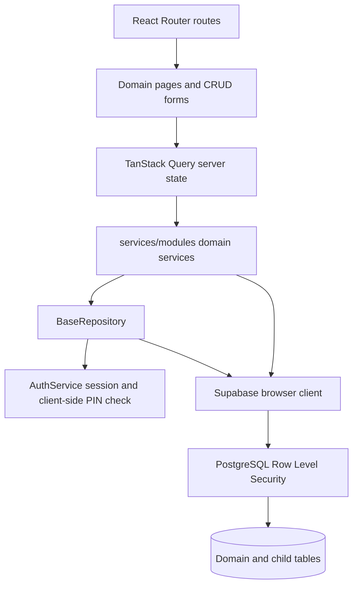
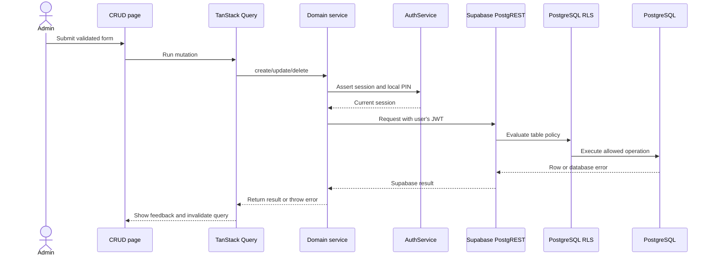
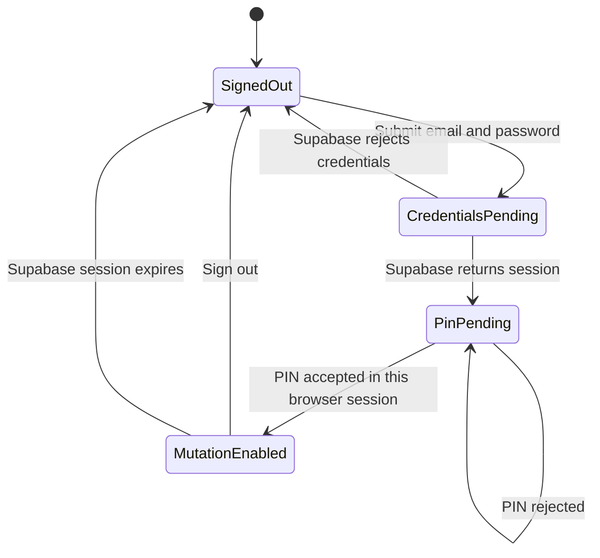
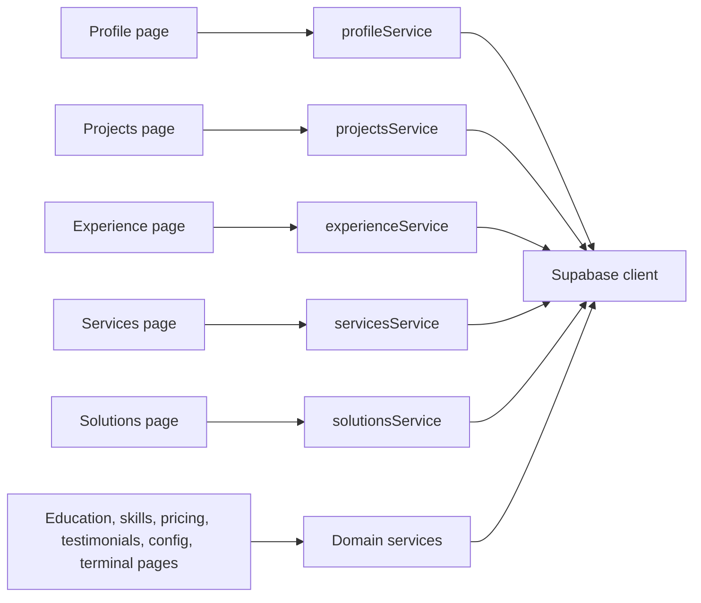

# Architecture

## Scope

`ego-admin` is a standalone Vite/React application for managing portfolio content. It is a browser client, not a trusted application server: domain services call Supabase directly with the public publishable key and the signed-in user's Supabase session. PostgreSQL RLS is the actual database authorization boundary.

## System Context



The frontend PIN prompt is a client-side gate only. It does not strengthen the JWT and must not be treated as database authorization. See [Security](SECURITY.md).

## Application Architecture



- Pages own presentation, forms, and TanStack Query mutations.
- Domain services own table-specific reads and child-row synchronization.
- `BaseRepository` supplies generic CRUD and mutation authorization checks.
- `AuthService` verifies the active Supabase session and local PIN state before repository mutations.
- Supabase RLS policies must independently enforce writes. Client checks are not a substitute for RLS.

## CRUD Request Sequence



Child-table changes are separate requests from parent writes; they are not a single database transaction. For operations that require all-or-nothing behavior, move the workflow into a PostgreSQL function/RPC and invoke that function from the domain service.

## Authentication State



The current implementation stores PIN verification in `sessionStorage`. It is cleared on logout or when the browser session ends. It is not Supabase MFA and is not independently verified by RLS.

## Domain Data Flow



## Source Layout

```text
apps/ego-admin/
|-- public/                         Static files served from the site root
|-- supabase/migrations/            SQL changes for the Supabase project
|-- docs/                           Architecture, schema, deployment, security
|-- src/
|   |-- App.jsx                     Route definitions
|   |-- components/
|   |   |-- common/                 Shared page and data-table primitives
|   |   |-- layout/                 Sidebar, header, route layout
|   |   `-- theme/                  Ant Design theme provider
|   |-- context/                    Auth context and session state
|   |-- core/                       Supabase client, repository, auth, logger
|   |-- pages/                      Dashboard and domain CRUD screens
|   |-- services/modules/           Domain repositories and services
|   |-- stores/                     Local UI state only
|   `-- styles/                     Tailwind and global styles
|-- index.html
|-- package.json
|-- netlify.toml
`-- vercel.json
```

For the exact table and column contract, see [Database](DATABASE.md). For build and rewrite configuration, see [Deployment](DEPLOYMENT.md).
