# Database and Data Model

## Supabase Access

The browser client uses `VITE_SUPABASE_URL` and `VITE_SUPABASE_PUBLISHABLE_KEY`. The publishable key is intentionally public; access control must come from grants and RLS policies. Never put a service-role key in a `VITE_*` variable or any browser bundle.

The admin performs direct PostgREST requests. Public portfolio reads and admin mutations use the same project but different policies. Child relations require their own `SELECT` policies for nested getters to return child rows.

## High-Level ERD

```mermaid
erDiagram
  PROFILE ||--o{ PROFILE_TYPEWRITER_TITLES : has
  PROFILE ||--o{ PROFILE_INTERESTS : has
  PROFILE ||--o{ ABOUT_FOCUS : defines
  PROJECTS ||--o{ PROJECT_TOOLS : uses
  PROJECTS ||--o{ PROJECT_IMAGES : displays
  PROJECTS ||--o{ PROJECT_CONTRIBUTORS : credits
  EXPERIENCE ||--o{ EXPERIENCE_TECH : uses
  SERVICES ||--o{ SERVICE_FULL_TECH_STACK : uses
  SERVICES ||--o{ SERVICE_IMPLEMENTATION_STEPS : describes
  SOLUTIONS ||--o{ SOLUTION_TECH : uses
  SKILL_CATEGORIES ||--o{ SKILL_CATEGORY_ITEMS : contains
  TERMINAL_CONFIG ||--o{ TERMINAL_PROTECTED_COMMANDS : protects
  TERMINAL_CONFIG ||--o{ TERMINAL_SECTION_MAP : routes
```



`skills` is a separate flat taxonomy table used by the current admin CRUD screen; the public site groups those records by their `category` value. `skill_categories` and `skill_category_items` are a separate relational representation and are fetched by the public service.

## Table Contract

| Domain | Parent table and columns | Child tables |
|---|---|---|
| Profile | `profile`: `id`, `name`, `designation`, `description`, `profile`, `heroimage`, `terminaluser`, `terminalpass`, `email`, `phone`, `address`, `github`, `instagram`, `linkedin`, `abouteyebrow`, `developerfilename`, `aboutfocuslabel`, `resumeurl`, timestamps | `profile_typewriter_titles`, `profile_interests`, `about_focus` |
| Projects | `projects`: `id`, `sortorder`, `name`, `description`, `role`, `code`, `demo`, `inprogress`, `websiteurl`, timestamps | `project_tools`, `project_images`, `project_contributors` |
| Experience | `experience`: `id`, `sortorder`, `title`, `company`, `duration`, `is_current`, `description`, `company_url`, timestamps | `experience_tech` |
| Education | `education`: `id`, `sortorder`, `title`, `duration`, `institution`, timestamps | None |
| Skills | `skills`: `id`, `name`, `category`, `glowcolor`, timestamps | `skill_categories`, `skill_category_items` |
| Services | `services`: `id`, `sortorder`, `name`, `icontype`, `description`, `problem`, `solution`, timestamps | `service_full_tech_stack`, `service_implementation_steps` |
| Solutions | `solutions`: `id`, `sortorder`, `title`, `category`, `description`, timestamps | `solution_tech` |
| Testimonials | `testimonials`: `id`, `name`, `title`, `company`, `imageurl`, `image`, `likes`, `stars`, `isvisible`, `testimonial`, timestamps | None |
| Pricing | `pricing`: `id`, `sortorder`, `name`, `price`, `pages`, `hasaws`, `hasdatabase`, `hasauth`, `aws`, `database`, `auth`, `databasesize`, `ispopular`, timestamps | None |
| Site config | `site_config`: `id`, `availabilitystatus`, `availabilitylabel`, `footertagline`, `devstack_os`, `devstack_editor`, `devstack_shell`, `devstack_framework`, `devstack_style`, `chaiboxtitle`, `chaiboxdescription`, `contactsectionintro`, `projectssectionsubtitle`, `solutionssectionsubtitle`, timestamps | None |
| Terminal | `terminal_config`: `id`, `version`, `defaultuser`, `defaultpass`, timestamps | `terminal_protected_commands`, `terminal_section_map` |

Child table columns are verified in the domain service payloads. Preserve exact PostgreSQL casing, especially `sortorder`, `company_url`, `profileurl`, `resumeurl`, and `heroimage`.

## Experience Status Migration

`supabase/migrations/20261012190000_experience_current_status.sql` adds `experience.is_current` and backfills it from existing `duration` values ending in `Present`. The admin and public site support the field while still recognizing legacy `Present` strings.

This file is not applied automatically. Before using the current-role toggle in the admin, apply the migration to the intended Supabase project using the Supabase CLI or SQL editor, then verify the column exists.

## RLS Migration

`supabase/migrations/20261012180000_admin_only_content_writes.sql` enables RLS and restricts writes to the configured admin Auth UID across the listed content tables. It deliberately does not replace existing `SELECT` policies. Review the target UID and current project policies before applying it.

RLS migration commands (run from this app directory after installing/linking the Supabase CLI):

```bash
supabase link --project-ref YOUR_PROJECT_REF
supabase db push
```

`supabase db push` changes database policy/schema state. Do not run it against production until the project ref and policy behavior have been reviewed. These migrations do not add or rewrite portfolio content except for the explicit `is_current` backfill.
