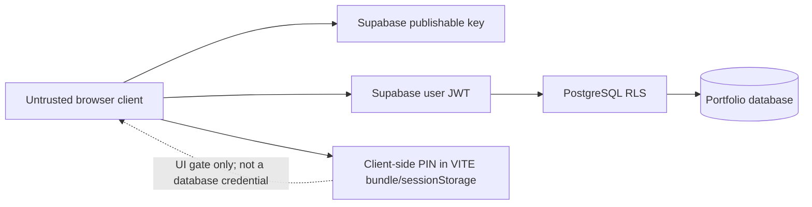

# Security Model

## Trust Boundaries

The browser is user-controlled. The publishable Supabase key and all `VITE_*` values are observable by visitors. A client-side PIN can improve the UI flow but cannot secure API calls. Only server-verified identity and database policies can enforce access to data.

## Required Controls

- Keep Supabase RLS enabled on every exposed table.
- Restrict `INSERT`, `UPDATE`, and `DELETE` policies to the intended authenticated admin UID or a trusted server-verified claim.
- Keep explicit `SELECT` policies for every parent and child table the public portfolio reads.
- Never use `service_role` in a browser build, `.env.example`, issue, chat, or documentation.
- Treat the current `VITE_ADMIN_2FA_PIN` approach as a convenience gate, not real two-factor authentication. Prefer Supabase Auth MFA and enforce the required assurance level in RLS for sensitive writes.
- Review the admin UID in `supabase/migrations/20261012180000_admin_only_content_writes.sql` before applying it.

## Environment and Credential Handling

- `.env` files are ignored by Git; commit only `.env.example` with blank values.
- Rotate credentials that have been pasted into chat, screenshots, source control, or build logs.
- Use the Supabase publishable key in the browser only with correct RLS policies.
- Store private CI/deployment credentials in the hosting provider's secret manager, never in source files.

## Incident Response

If a private key or token is exposed, revoke it at its issuer immediately, issue a replacement, update deployment settings, and review provider/database audit logs. If a database write is unexpectedly allowed, disable the relevant policy or revoke the session first, then audit policies for permissive rules that combine with the intended admin policy.
